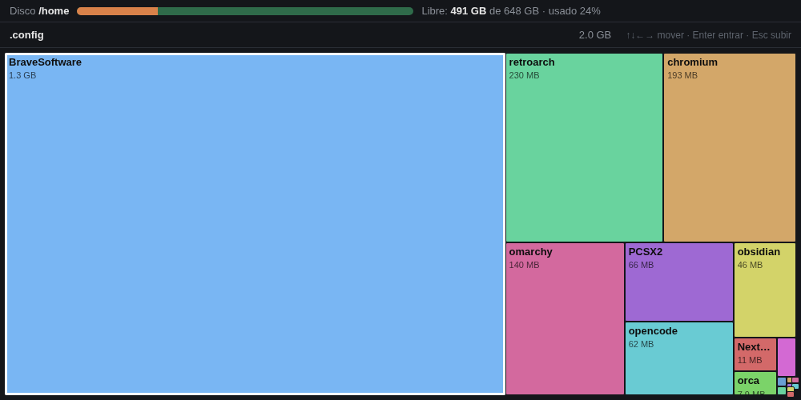

# Analizador de espacio para omarchy

Mira de un vistazo qué carpetas y archivos ocupan más espacio, con **click derecho** desde Nautilus. Pensado como alternativa ligera a WizTree para [Omarchy](https://omarchy.org) (Arch Linux + Hyprland), y funciona también con la memoria de un **teléfono Android conectado por USB**.



## Qué incluye

| Herramienta | Qué hace |
|---|---|
| `treemap` | Vista **gráfica** (treemap): cada rectángulo es proporcional a su tamaño. Navegable con teclado y mouse. |
| `android-du` | Lista en terminal las carpetas del teléfono ordenadas por tamaño. |
| Script de Nautilus **Analizar espacio (grafico)** | Click derecho → abre el treemap de esa carpeta (del PC o del teléfono). |
| Script de Nautilus **Analizar espacio** | Click derecho → abre [`gdu`](https://github.com/dundee/gdu) (TUI) en una terminal. |

### Características del treemap

- Barra superior con el **espacio libre** del disco (o del teléfono).
- Escaneo **por niveles**: cada escaneo cubre 4 niveles. Al entrar a una carpeta que aún no se escaneó, muestra "Escaneando…" con un contador y sigue bajando.
- Navegación con teclado: `←` `↑` `↓` `→` mueven la selección, `Enter` entra, `Esc` / `Backspace` suben.
- Tooltip con nombre, tamaño y porcentaje respecto a la carpeta actual.
- Android: el cálculo de tamaños lo hace el propio teléfono vía `adb`, mucho más rápido que recorrerlo por MTP.

## Instalación

Dependencias:

```bash
sudo pacman -S --needed python chromium nautilus gdu android-tools
```

`gdu` solo se usa para la vista TUI y `android-tools` (adb) solo para Android.

```bash
git clone https://github.com/Carlotess/analizador-de-espacio-omarchy.git
cd analizador-de-espacio-omarchy
./install.sh
```

Esto copia los comandos a `~/.local/bin` y los scripts a `~/.local/share/nautilus/scripts`, y reinicia Nautilus. Para desinstalar: `./install.sh --uninstall`.

## Uso

### Desde Nautilus

Click derecho sobre una carpeta → **Scripts** → **Analizar espacio (grafico)** (o **Analizar espacio** para la TUI).
Si Nautilus está abierto dentro del teléfono (`mtp://…`), analiza esa carpeta del teléfono automáticamente.

### Desde la terminal

```bash
treemap ~/Descargas               # carpeta local
treemap -d 6 /                    # escanear 6 niveles de entrada
treemap --android                 # /sdcard del teléfono
treemap --android /sdcard/DCIM    # una carpeta concreta del teléfono

android-du                        # tamaños de /sdcard en texto
android-du /sdcard/Android 50     # ruta y cuántas líneas mostrar
```

### Atajos en el treemap

| Tecla | Acción |
|---|---|
| `←` `↑` `↓` `→` | Mover la selección |
| `Enter` / click | Entrar a la carpeta |
| `Esc` / `Backspace` | Subir un nivel |

## Android

1. Activa **Opciones de desarrollador → Depuración USB** en el teléfono.
2. Conéctalo por USB y acepta el diálogo "¿Permitir depuración USB?".
3. Comprueba que `adb devices` muestre el equipo como `device` (no `unauthorized`).

## Cómo funciona

`treemap` escanea con `du` (en Android, `adb shell du` + `find`) y levanta un servidor HTTP **solo en `127.0.0.1`**, con una clave aleatoria en la URL, que sirve la página y responde a las peticiones de escaneo. Solo permite escanear dentro de la carpeta que abriste. La ventana se abre con Chromium en modo `--app`. Cuando la cierras, el servidor termina solo unos segundos después.

## Limitaciones

- Los tamaños usan 1 GB = 1024 MB, así que un disco de "696 GB" del fabricante aparece como 648 GB.
- No hay opción de borrar desde el treemap; para eso usa la vista TUI (`gdu`, tecla `d`).
- Escanear una carpeta enorme o un teléfono lleno puede tardar; por eso se escanea por niveles.
- Se escanea una vez: si los archivos cambian, hay que volver a abrir la herramienta.

## Licencia

MIT — ver [LICENSE](LICENSE).
